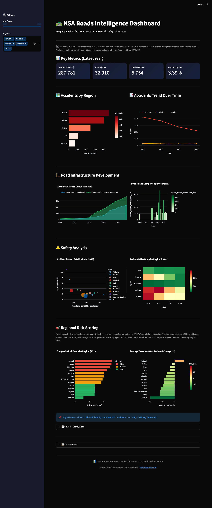

# KSA Roads Intelligence Dashboard

Interactive data visualization of Saudi Arabia's road infrastructure and traffic safety metrics. Built to demonstrate Data/BI skills using real KSA government open data.

**Live demo:** [ksa-roads-intelligence-production.up.railway.app](https://ksa-roads-intelligence-production.up.railway.app)



## 🎯 Problem Statement

Saudi Arabia's Vision 2030 involves massive infrastructure development including NEOM, Red Sea Project, and Qiddiya. City planners and transport authorities need consolidated visibility into:

- Current road network utilization
- Traffic accident hotspots by region
- Infrastructure investment trends
- Safety metrics to prioritize interventions

Currently, this data is siloed across multiple government agencies (MOT, GASTAT, KAPSARC).

## 💡 Solution

A unified dashboard that combines multiple Saudi transportation datasets pulled live from KAPSARC:

- **Traffic Accidents by Region** (2016-2019): Accidents, injuries, deaths, region-level population reference
- **Road Development** (1990-2013, non-continuous): Paved roads and agricultural dirt roads completed per year
- Cross-regional safety analysis with derived metrics (accidents per 100K, fatality rate)

> KAPSARC's road-development series and accident series don't share a time range, and KAPSARC doesn't publish an investment/spend dataset — so there's no investment-vs-outcome chart. Population figures are approximate reference values, not a KAPSARC field. Falls back to bundled synthetic sample data (clearly labeled in-app) if `scripts/download_data.py` hasn't been run or KAPSARC is unreachable.

## 📊 Key Visualizations

1. **Regional Accident Distribution** - Horizontal bar chart showing accident counts by region
2. **Trend Analysis** - Time-series of accidents, injuries, and deaths
3. **Cumulative Roads Completed** - Area chart of paved + dirt road completions since 1990
4. **Paved Roads Completed per Year** - Annual completion bar chart
5. **Safety Scatter Plot** - Accident rate vs fatality rate by region
6. **Heatmap** - Accidents by region and year
7. **Regional Risk Scoring** - Composite risk score (fatality rate + accident rate + trend) ranking regions High/Medium/Low
8. **Year-over-Year Trend** - Average YoY accident change by region

> No ARIMA/Prophet forecasting — the real accident data is annual with only 4 years per region, too thin to forecast reliably. Risk scoring was chosen as the honest alternative; see `docs/PRD.md` section 04 for the full rationale.

## 🛠 Tech Stack

| Component | Technology |
|-----------|------------|
| Dashboard | Streamlit |
| Data Processing | Pandas |
| Visualization | Plotly |
| Data Source | KAPSARC Open Data |
| Deployment | Railway / Render |

## 🚀 Quick Start

### Prerequisites

- Python 3.9+
- pip

### Installation

```bash
# Clone the repo
git clone https://github.com/ramdev9/ksa-roads-intelligence.git
cd ksa-roads-intelligence

# Install dependencies
pip install -r requirements.txt

# Download real KAPSARC data (recommended; dashboard falls back to sample data if skipped)
python scripts/download_data.py

# Run the dashboard
streamlit run src/dashboard.py
```

Open http://localhost:8501 in your browser.

## 📁 Project Structure

```
ksa-roads-intelligence/
├── data/
│   ├── raw/                    # Downloaded datasets
│   │   ├── sample_traffic_accidents.csv
│   │   └── sample_road_development.csv
│   └── processed/              # Cleaned data
├── src/
│   ├── data_loader.py          # Data loading utilities
│   └── dashboard.py            # Streamlit app
├── scripts/
│   └── download_data.py        # KAPSARC data downloader
├── notebooks/                  # Exploratory analysis
├── .streamlit/
│   └── config.toml             # Streamlit theme config
├── requirements.txt
└── README.md
```

## 📦 Data Sources

All data from [KAPSARC Open Data Portal](https://datasource.kapsarc.org):

| Dataset | Description | Years |
|---------|-------------|-------|
| Traffic Accidents | Accidents and casualties by region | 2008+ |
| King Fahd Bridge Traffic | Monthly vehicle crossings | 2009-2019 |
| Passenger & Freight Vehicles | Vehicle counts by type | Various |
| Road Development | Paved/rural roads construction | 2010+ |

## 🔮 Future Enhancements

- [ ] Add predictive model for accident forecasting
- [ ] Integrate real-time traffic data (if API available)
- [ ] Add interactive map visualization
- [ ] Include more GASTAT datasets
- [ ] Add Arabic language support

## 📄 License

MIT License

## 👤 Author

**Ram Nimbalker** - AI Product Manager  
[madebyram.com](https://madebyram.com) | [LinkedIn](https://linkedin.com/in/ramnimbalker)

---

*Part of my AI PM portfolio demonstrating Data/BI product skills for Vision 2030 context.*
